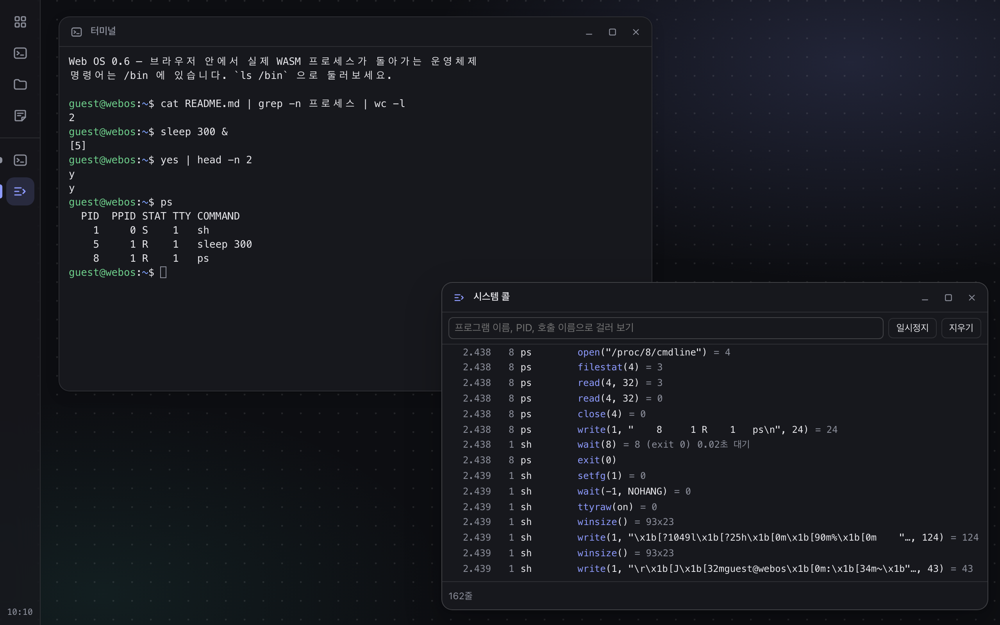

# Web OS

브라우저 탭 안에서 돌아가는 작은 운영체제입니다.

터미널의 명령은 흉내 낸 함수가 아니라 **Rust로 작성해 WebAssembly로 컴파일한 실제 프로그램**이고, 각각 별도의 프로세스(Web Worker)로 실행되어 커널에 시스템 콜을 보냅니다. 커널은 WASI(WebAssembly 표준 시스템 인터페이스)를 구현하므로, WASI용으로 컴파일한 프로그램을 창에 끌어다 놓으면 그대로 실행됩니다.

**써 보기: https://web-os-puce-eta.vercel.app** (데스크톱의 Chrome·Edge 권장)



## 해 볼 만한 것

```sh
ls -l /bin                          # 어떤 프로그램이 있는지
cat README.md | grep -n 프로세스 | wc -l   # 프로세스 세 개를 파이프로 잇기
yes | head -n 3                     # head가 끝나면 yes도 함께 끝난다
spin                                # CPU를 계속 쓰는 프로그램. 화면은 멈추지 않는다 (Ctrl+C)
top                                 # 실시간 프로세스 목록 (q로 나가기)
vi notes.txt                        # 터미널 안의 모드형 편집기
ps | grep -E '^ +[0-9]+ +1 '        # 정규식으로 고르기: 셸이 띄운 프로세스만
cat /proc/self/status               # 지금 이 cat 자신의 정보
```

- **시스템 콜** 앱을 열어 둔 채 명령을 실행하면, 그 프로그램이 커널에 보내는 요청이 한 줄씩 흐릅니다.
- **파일** 앱에 직접 컴파일한 `.wasm` 파일을 끌어다 놓고 터미널에서 `./이름.wasm`으로 실행할 수 있습니다.
- **파일**, **메모**, **그림판**, **음악**은 화면까지 직접 그리는 프로세스입니다. 메모의 폴더 트리, 탭, 마크다운 미리보기, 링크 그래프가 모두 Rust 프로그램이 보낸 그리기 명령이고, 터미널에서 `files &`, `notepad &`, `paint &`로도 뜨며 `ps`에 나옵니다.
- 파일은 새로고침해도 남습니다. **설정**에서 컴퓨터의 폴더 하나를 보관 폴더로 정하면 실제 파일로도 저장됩니다.

## 구조

```
┌─ 메인 스레드: 화면 ───────────────────────────────┐
│  창 관리자 · 앱(터미널, 파일, 편집기 …) · 터미널 에뮬레이터      │
└──────────────┬────────────────────────────────┘
               │ 메시지
┌─ 커널 Worker ┴────────────────────────────────┐
│  프로세스 테이블 · 시스템 콜 · 파이프 · 터미널 장치(TTY)        │
│  메모리 파일시스템 · /proc · 저장(브라우저 저장소, 보관 폴더)   │
└──────────────┬────────────────────────────────┘
               │ 시스템 콜 (SharedArrayBuffer + Atomics)
┌─ 프로세스 Worker × N ─────────────────────────┐
│  WASM 바이너리: 셸, 기본 명령어, 사용자가 올린 프로그램        │
└───────────────────────────────────────────────┘
```

- **블로킹 시스템 콜.** 프로세스가 `read()`를 부르면 공유 메모리에서 `Atomics.wait`로 실제로 멈추고, 커널이 결과를 쓴 뒤 깨웁니다. 그래서 동기식으로 짜인 보통의 프로그램이 수정 없이 동작합니다.
- **프로세스 격리.** 프로세스 하나가 무한 루프에 빠져도 화면과 다른 프로세스는 멈추지 않고, 종료시키면 그 Worker가 실제로 끝납니다.
- **미룰 수 있는 응답.** 빈 파이프 읽기, 자식 종료 대기, 키 입력 대기처럼 지금 끝낼 수 없는 호출은 커널이 응답을 미뤄 두었다가 조건이 되면 다시 실행합니다.
- **멈춤과 다시 움직임.** Ctrl+Z를 누르면 커널이 전경의 프로세스를 멈춤으로 표시하고, 그 프로세스의 다음 시스템 콜에 답하지 않습니다. `fg`나 `bg`가 다시 움직이게 하면 미뤄 둔 호출이 이어집니다.
- **네트워크.** 프로그램은 주소를 커널에 넘기고(`fetch`), 커널이 받아 온 본문을 파일처럼 읽습니다. `curl`이 이렇게 동작합니다.
- **터미널.** 줄 편집과 Ctrl+C를 처리하는 터미널 장치는 커널에, 색·커서 이동·대체 화면을 해석하는 에뮬레이터는 화면 쪽에 있습니다. 둘 다 라이브러리 없이 직접 구현했습니다.
- **창을 여는 프로세스.** 프로세스는 시스템 콜로 창을 열고(`guiopen`), 도형과 글자를 그리라는 명령 묶음을 보내고(`guidraw`), 마우스·키보드 입력을 기다립니다(`guievent`). 픽셀이 아니라 명령을 보내므로 글자는 화면 쪽 글꼴로 그려지고 고해상도에서도 선명합니다. 글을 치는 곳은 "이 자리에 입력 칸을 놓아라"는 명령으로 화면의 실제 입력 칸을 빌려 쓰고(한글 조합, 복사·붙여넣기가 그대로 됩니다), 그 내용은 시스템 콜로 주고받습니다(`guitext`, `guisettext`). 글자의 폭은 화면 쪽에 물어보고(`guimeasure`), 그 폭으로 프로그램이 직접 줄을 나눠 배치합니다. 입력 칸의 커서가 어디 있는지도 알려 주므로, 목록 이어 쓰기나 링크 자동 완성처럼 친 글을 고쳐 쓰는 일도 프로그램이 합니다 (그사이 사용자가 더 친 글자가 있으면 고쳐 쓰기를 버려서, 친 글자가 지워지지 않게 합니다). 그림은 파일의 경로로 가리켜 그리게 하고(`guiimage`), 입력 칸의 글에 입힐 문법 색상도 프로그램이 범위와 색으로 정해 보냅니다(`guistyle`). 사용자가 고르거나 끌어다 놓은 파일은 임시 폴더에 놓여 프로그램에 건네집니다. 우클릭 메뉴는 시스템의 메뉴를 띄워 달라고 하고, 그림 속의 단추와 항목이 어디에 있는지도 함께 알려서 화면 낭독기가 읽고 누를 수 있습니다.
- **바깥 플레이어.** 음악 프로그램은 영상을 직접 틀지 않습니다. "이 자리에 플레이어를 놓고 이 영상을 틀어라"고 화면에 시키고, 상태(틀고 있음, 끝남, 오류)를 이벤트로 돌려받습니다. 이 페이지는 다른 출처의 것을 막아 둔 상태라, 화면 쪽은 쿠키 없이 여는 iframe으로 유튜브의 공식 플레이어를 놓습니다.
- **저장.** 읽고 쓰는 일은 모두 메모리에서 일어나고, 바뀐 부분만 조금 뒤에 브라우저 저장소(OPFS)와 보관 폴더로 옮깁니다.

설계 배경과 단계별 진행 상황은 [docs/PLAN.md](docs/PLAN.md)에 있습니다.

## 들어 있는 것

| 구분 | 내용 |
|---|---|
| 셸 (`sh`) | 파이프, 리다이렉션(`<` `>` `>>`), `;` `&&` `\|\|`, 배경 실행(`&`)과 작업 제어(Ctrl+Z, `jobs` `fg` `bg`), 변수, 와일드카드(`*` `?`), 스크립트 실행, 방향키 이력, 탭 자동완성 |
| 명령어 | `cat` `clear` `cp` `curl` `echo` `env` `false` `grep` `head` `kill` `ls` `mkdir` `mv` `ps` `pwd` `rm` `sleep` `tail` `top` `touch` `true` `vi` `wc` `yes` |
| 프로그램 (창) | `files` 파일: 폴더 둘러보기, 만들기·이름 바꾸기·지우기, 끌어다 놓아 올리기. `music` 음악: 등록한 곡을 유튜브의 플레이어로 틀기 (아티스트별·앨범별 보기, 글처럼 쓰는 플레이리스트, 섞기, 반복). `paint` 그림판: 색·굵기 선택, 되돌리기, SVG로 저장. `notepad` 메모: 폴더로 정리한 마크다운 메모 (폴더 트리, 탭, 편집·나란히·읽기, `[[링크]]`와 백링크, 목차·태그, 그래프, 빠른 열기, 끌어서 옮기기, 목록 이어 쓰기와 링크 자동 완성, `/` 명령 모음, 그림, 문법 색상, 휴대폰용 배치) |
| 앱 | 터미널, 편집기(문법 색상, 마크다운·JSON·CSV 미리보기), 프로세스, 시스템 콜, 시스템 로그, 설정 |
| 화면 | 창 이동·크기 조절·가장자리 붙이기·최소화, 실행 메뉴, 밝은·어두운 테마, 휴대폰용 화면 |
| 저장 | 새로고침 후에도 유지, 로컬 보관 폴더, 백업 파일(tar) 내보내기·되살리기, 한 번에 한 탭만 실행 |

## 음악 보관함 고치기

음악 앱의 보관함은 [rootfs/usr/share/music](rootfs/usr/share/music) 아래의 글 파일들입니다.

**곡 목록** (`songs.txt`): 등록한 곡을 한 줄에 하나씩 적습니다. 아티스트별·앨범별 보기는 여기 적은 것으로 만들어집니다. 곡 아래에 들여 쓴 줄들은 그 곡에 대한 글입니다.

```
https://youtu.be/영상번호 | 제목 | 아티스트 | 앨범
    이 곡에 대해 쓰고 싶은 글.
https://www.youtube.com/watch?v=영상번호
```

제목과 아티스트는 비워 두면 유튜브에서 받아 옵니다.

**플레이리스트** (`playlists/*.md`): 글 한 편이 플레이리스트 하나입니다. 유튜브 주소만 적은 줄이 곡이 되고, 그 아래의 글은 그 곡에 대한 이야기, 첫 곡보다 앞의 글은 소개글이 됩니다. 앱에서는 글처럼 읽히고, 곡의 차례대로 재생됩니다.

```
# 비 오는 날
날짜: 2026-11-26

창밖을 보다가 골랐다.

https://youtu.be/영상번호
이 곡으로 시작하는 까닭.

https://youtu.be/영상번호
```

새 플레이리스트의 뼈대는 명령으로 만듭니다. 만든 파일에 소개글과 곡마다의 이야기를 쓰고 커밋해서 배포하면, 누구나 보는 플레이리스트가 됩니다.

```sh
pnpm playlist "비 오는 날" https://youtu.be/영상번호 https://youtu.be/영상번호
# → rootfs/usr/share/music/playlists/2026-11-26-비-오는-날.md
```

`/usr` 아래의 파일은 켤 때마다 새것으로 맞추므로, 고쳐서 배포하면 다시 방문한 사람에게도 바뀐 보관함이 보입니다. 방문자는 자기 것을 `~/music/songs.txt`와 `~/music/playlists/*.md`에 같은 형식으로 둘 수 있습니다.

## 개발

도구 버전은 [mise](https://mise.jdx.dev)로 고정해 두었습니다 (Node 24, pnpm 10, Rust stable + `wasm32-wasip1`).

```sh
mise install        # 도구 설치
pnpm install
pnpm dev            # Rust 프로그램을 빌드하고 개발 서버 실행
```

| 명령 | 하는 일 |
|---|---|
| `pnpm dev` | `programs/`의 Rust 프로그램을 WASM으로 빌드한 뒤 개발 서버를 띄웁니다 |
| `pnpm test` | 단위·통합 테스트. 커널 위에서 실제 바이너리를 스레드로 돌려 검증하고, Rust 프로그램 안의 단위 테스트(`cargo test`)도 함께 돌립니다 |
| `pnpm e2e` | 배포용으로 빌드한 뒤 실제 브라우저(Chromium)에서 종단 테스트를 돌립니다. 처음 한 번은 `pnpm exec playwright install chromium`이 필요합니다 |
| `pnpm build` | 타입 검사 후 배포용 빌드 (`dist/`) |

### 폴더

```
programs/     Rust 프로그램 (WASM으로 빌드되어 /bin 에 들어간다)
  webos/        커널의 확장 기능(프로세스 생성, 파이프, 터미널 제어, 창)을 감싼 라이브러리와, 창을 그리는 프로그램들이 함께 쓰는 그리기 도우미
  paint/        그림판 (창을 직접 그리는 프로그램)
  notepad/      메모 (마크다운 해석과 배치까지 직접 하는 프로그램)
  files/        파일 탐색기
  music/        음악 (유튜브의 플레이어를 창에 놓고 부리는 프로그램)
  sh/           셸과 줄 편집기
  coreutils/    기본 명령어
rootfs/       처음 시작할 때 깔리는 기본 파일
src/kernel/   커널: 시스템 콜, 프로세스, 파일시스템, 터미널 장치, 저장
src/process/  프로세스 Worker와 WASI 구현
src/ui/       화면: 창 관리자, 앱, 터미널 에뮬레이터
tests/        단위·통합 테스트
e2e/          브라우저 종단 테스트
```

## 배포

`SharedArrayBuffer`를 쓰려면 페이지가 교차 출처 격리 상태여야 하므로, 모든 응답에 아래 헤더가 필요합니다. 없으면 사이트가 아예 뜨지 않고 안내문만 나옵니다.

```
Cross-Origin-Opener-Policy: same-origin
Cross-Origin-Embedder-Policy: require-corp
```

Vercel용 설정은 [vercel.json](vercel.json)에 있습니다. 빌드 전에 Rust를 설치하고, 위 헤더를 붙입니다.

## 브라우저

- **데스크톱 Chrome·Edge:** 모든 기능이 됩니다.
- **Safari, Firefox, 휴대폰:** 기본 기능은 되지만, 컴퓨터의 폴더를 다루는 보관 폴더는 쓸 수 없습니다 (백업 파일은 어디서나 됩니다).

## 알려진 한계

- 파일, 메모, 그림판을 뺀 화면 앱(편집기, 설정 등)은 프로세스가 아니라 메인 스레드에서 돌며 커널에 파일 작업을 요청합니다. 그래서 `ps`에 나오지 않습니다.
- 메모의 미리보기에서 바깥 사이트의 그림은 보이지 않습니다 (이 페이지는 다른 출처의 자원을 막아 둔 상태입니다). 바깥 링크는 새 탭으로 열립니다.
- 프로세스 생성은 `spawn` 방식만 지원합니다 (`fork` 없음).
- 프로세스별 CPU 사용률은 보여 주지 않습니다.
- 멈춤(Ctrl+Z, `kill -STOP`)은 프로세스가 다음 시스템 콜을 부를 때 걸립니다. 시스템 콜 없이 계산만 하는 동안에는 멈추지 않습니다 (Worker를 바깥에서 세울 방법이 없습니다).
- 음악은 Chrome·Edge에서만 창 안에서 재생됩니다 (쿠키 없이 여는 iframe이 필요합니다). 다른 브라우저에서는 "유튜브에서 열기"를 안내합니다. 퍼가기를 막아 둔 영상은 건너뜁니다.
- `curl`은 브라우저의 규칙을 따르므로, 다른 사이트의 것은 그 사이트가 허락한 경우(CORS)에만 받아 옵니다.
- `vi`는 기본 명령만 지원합니다 (숫자 반복, 시각 모드, 치환 없음).
